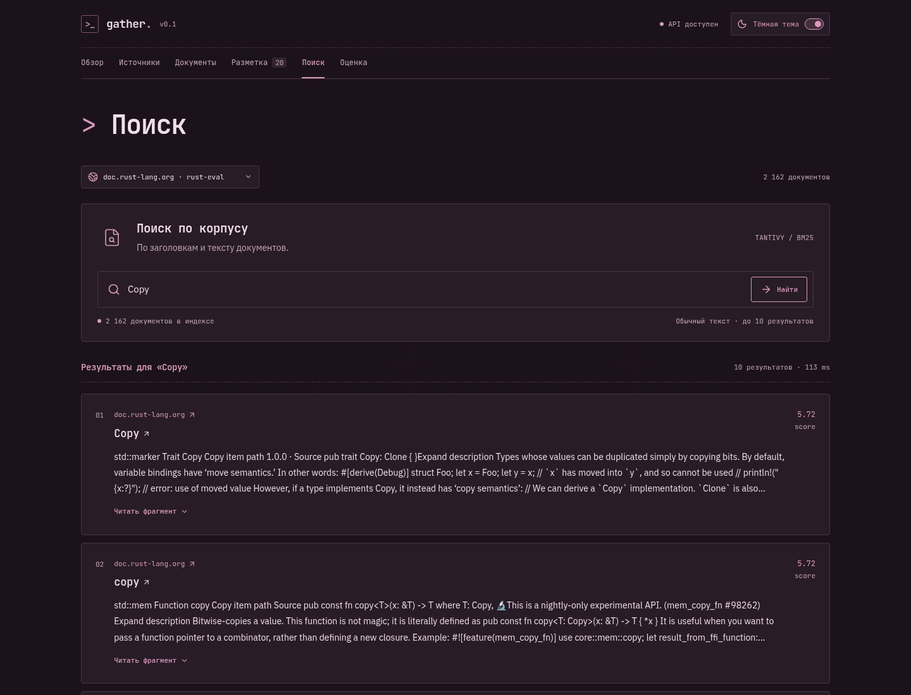
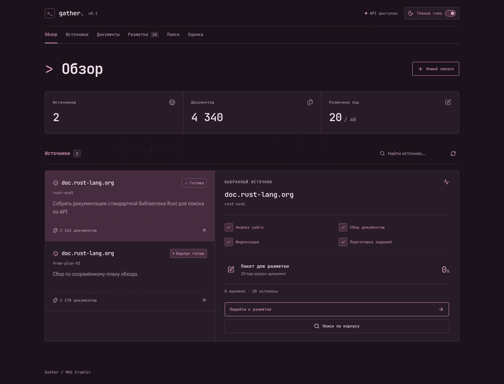
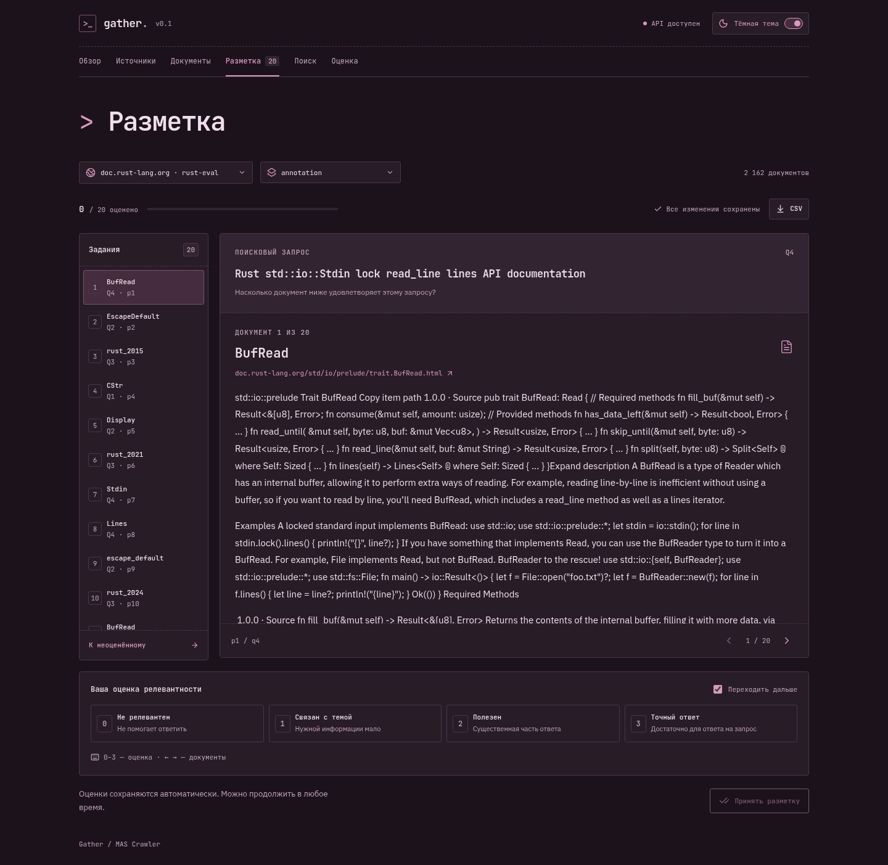
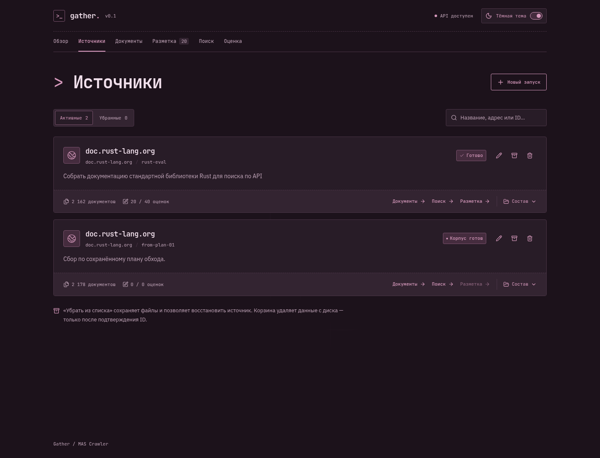
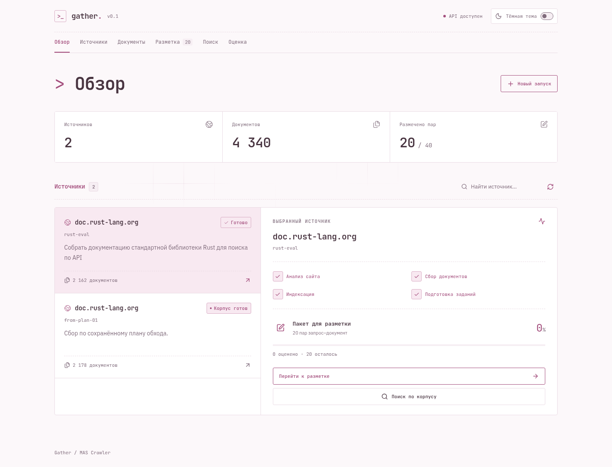
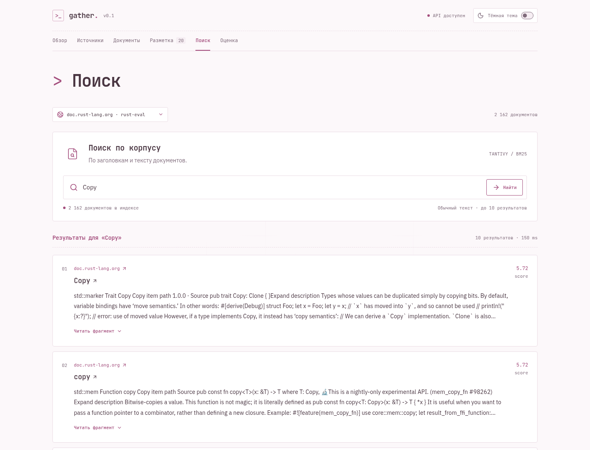

# MAS Crawler [MVP]




Краулер, который собирает документы сайта и строит по ним поисковый индекс. На вход нужны URL и цель, например «собрать документацию стандартной библиотеки Rust». LLM-агент подбирает правила обхода и извлечения текста, Rust выполняет сбор и индексацию.

Из URL и цели можно получить корпус, поисковый индекс и пакет для разметки релевантности. Доступны локальный веб-интерфейс, CLI, Python API, BM25, векторный и гибридный поиск, сравнение BM25-конфигураций по принятой разметке. Автономный подбор настроек пока в планах.

## Как устроен

1. **Explorer** исследует страницы, читает HTML и проверяет CSS-селекторы минимум на двух документах. Результат - `CrawlPlan` с областью обхода, паттернами URL, селекторами и лимитом запросов.
2. **Rust-движок** обходит сайт через Spider и reqwest, извлекает текст через scraper и сохраняет JSONL-корпус. Массовый сбор работает без LLM.
3. **Tantivy** строит индекс по заголовкам и тексту. В BM25 можно менять веса этих полей и сравнивать конфигурации на одном индексе.
4. **Подготовка датасета** выбирает документы корпуса, генерирует запросы через LLM и подбирает кандидатов поиском с разными весами полей. Оценки релевантности заполняет разметчик; отдельная команда принимает CSV и фиксирует dev/test.

Анализ, сбор и индексацию связывает LangGraph; подготовка датасета последовательно вызывает сборку и генерацию заданий. Python обращается к Rust через PyO3; сборкой пакета занимается maturin.

## Шаблон независимого поискового сервиса

В [templates/search-service](templates/search-service/README.md) находится отдельный редактируемый проект: FastAPI API, Rust/Tantivy BM25, TOML-конфигурация, пересборка индекса, Dockerfile и тесты. Скопированный каталог собирается без Gather, агентов и зависимостей от родительского репозитория. В шаблоне есть искусственный демонстрационный корпус; вместо него можно использовать собранный `corpus.jsonl`. Автоматический экспорт выбранного эксперимента в этот шаблон пока не реализован.

Поисковый Rust-модуль в шаблоне — самостоятельный снимок `core/src/search.rs`. После изменения исходного движка выполните `python tools/sync_search_template.py` и тесты шаблона; `python tools/sync_search_template.py --check` проверяет отсутствие расхождений. Пользователю скопированного проекта эта синхронизация не нужна.

## Установка

Нужны Python 3.12+, uv, Rust toolchain с поддержкой edition 2024 и системный линкер. Команды выполняются из корня репозитория.

```bash
cargo install just --locked
just setup
```

Для анализа сайта создайте `.env` с доступом к OpenAI-совместимому API:

```dotenv
LLM_API_KEY=your-api-key
LLM_BASE_URL=https://your-provider.example/v1
```

Модель и бюджеты анализа задаются в [config.toml](config.toml). `LLM_BASE_URL` имеет приоритет над `llm.base_url`; ключ хранится в окружении или `.env`.

Для обхода по готовому плану, индексации и поиска ключ не нужен.

## Веб-интерфейс

Gather - локальное рабочее пространство для запусков, разметки, поиска и оценки. Для сборки интерфейса дополнительно нужны Node.js 22.12+ и npm:

```bash
just ui-build
just ui
```

Откройте `http://127.0.0.1:8000`. FastAPI обслуживает API и собранный React-интерфейс с одного адреса. Уже существующие запуски из `runs/` доступны автоматически; для нового укажите URL, цель и бюджет пар. Сбор выполняется в отдельном процессе, закрытие вкладки его не останавливает. Интерфейс показывает этапы и доступные счётчики, а не расчётный процент или ETA обхода.


(holy slope)

В разметке доступны оценки 0–3, горячие клавиши, автоматический переход и экспорт CSV. Промежуточные оценки сохраняются на сервере в `ui-labels.json` внутри пакета; исходные задания не меняются. Кнопка приёма фиксирует dev/test и блокирует редактирование принятого пакета. Поиск работает по готовому индексу, сравнение двух конфигураций - только по dev; test не используется для подбора настроек. Пакеты с тестовой разметкой ассистента отмечены отдельно.




Интерфейс поддерживает **светлую и тёмную темы**. Переключатель находится в шапке; выбранная тема сохраняется между посещениями. Выше показана тёмная тема, ниже — примеры светлой.

<details>
<summary>Светлая тема — обзор и поиск</summary>




</details>

Для разработки запустите `just ui` и во втором терминале `just ui-dev`. Vite проксирует `/api` на порт 8000. и без платных вызовов. Нужен Chromium (`/usr/bin/chromium` или путь в `CHROMIUM_PATH`). Рабочие запуски из `runs/` в тестах не меняются.

## Docker

Образ собирает UI и запускает его вместе с API:

```bash
docker build -t mas-crawler .
docker run -d --name mas-crawler \
  -p 127.0.0.1:8000:8000 \
  -v mas-crawler-data:/data --env-file .env mas-crawler
```

Интерфейс: `http://127.0.0.1:8000`. Запуски сохраняются в volume. Без LLM можно убрать `--env-file .env`. 

## Запуск через CLI

Сначала подготовьте план:

```bash
just analyze https://doc.rust-lang.org/std/index.html \
  --goal "Собрать страницы документации стандартной библиотеки Rust" \
  --output crawl-plan.json
```

Просмотрите `crawl-plan.json`: проверьте область `scope_prefix`, паттерны `document_url_patterns`, CSS-селекторы и лимит `max_pages`. Затем соберите документы и индекс:

```bash
just build --plan crawl-plan.json --run-dir runs/from-plan
just search --index runs/from-plan/index --query "Iterator" --top-k 5
```

Для полного цикла без промежуточного просмотра плана:

```bash
just build https://doc.rust-lang.org/std/index.html \
  --goal "Собрать страницы документации стандартной библиотеки Rust" \
  --run-dir runs/rust-docs
```

Каталог запуска должен быть новым. После успешного `build` в нём находятся:

- `crawl-plan.json` - план обхода;
- `corpus.jsonl` - документы с полями `url`, `title`, `text`;
- `crawl-report.json` - число успешных загрузок, ошибки и достижение лимита;
- `index/` - поисковый индекс;
- `result.json` - итоговые пути и число проиндексированных документов.

Ошибки отдельных страниц остаются в отчёте, успешно собранные документы попадают в индекс. При пустом корпусе сборка останавливается. После сбоя могут остаться частичные артефакты; возобновления пока нет. Планы, корпуса и каталог `runs/` исключены из Git.

Существующие файлы плана и корпуса не перезаписываются; индекс создаётся в новом каталоге. Родительский каталог для `--output` должен существовать.

`experiment` запускает пакет поисковых конфигураций и возвращает их выдачи. Параметры доступны через `just experiment --help`; оценка по разметке показана в Python API ниже. У остальных прикладных команд также есть `--help`.

## Настройки

По умолчанию Python-рецепты используют `config.toml` из корня проекта. Там задаются модель, бюджет загрузок Explorer, размеры HTML-фрагментов и лимиты шагов. Другой TOML можно выбрать через переменную just:

```bash
just --set app_config custom.toml analyze https://doc.rust-lang.org/std/index.html \
  --goal "Собрать страницы документации стандартной библиотеки Rust" \
  --output custom-plan.json
```

Правила конкретного сайта и лимит массового сбора хранятся в `CrawlPlan`. Таймауты и параллелизм обхода пока заданы в Rust-коде. Веса поиска передаются отдельно: через Python API или JSON-файл `--config` у Rust-команды `search`.

## Выдача и приём датасета

Для подготовки заданий сразу из URL и цели используйте `dataset`. Команда вызывает LLM для анализа сайта и генерации запросов; каталог `--run-dir` должен быть новым:

```bash
just dataset https://doc.rust-lang.org/std/ \
  --goal "Собрать документацию стандартной библиотеки Rust для поиска по API" \
  --run-dir runs/rust-eval --max-pairs 20
```

После успеха каталог содержит артефакты `build`, пакет `annotation/` и общий отчёт `dataset-result.json`. CSV пока содержит задания без оценок, а не готовый размеченный benchmark. `--max-pairs` ограничивает число пар запрос–документ, но не объём обхода: лимит сбора задаётся в `CrawlPlan`.

Если корпус и индекс уже готовы, используйте отдельный `benchmark prepare`. Это также позволяет повторить генерацию после её сбоя без нового обхода сайта; каталог `--output-dir` должен быть новым:

```bash
just benchmark prepare \
  --corpus runs/from-plan/corpus.jsonl --index runs/from-plan/index \
  --goal "Проверить поиск по документации стандартной библиотеки Rust" \
  --max-pairs 100 --output-dir runs/from-plan/annotation
```

Пользователю передаётся `annotation/annotation.csv`. Заполните `relevance` целыми оценками 0–3 и сохраните CSV в UTF-8. Менять можно только оценки и порядок строк; все задания нужно вернуть. `source.json` - исходные задания и сведения о генерации, его не редактируют и не передают разметчику. Между выдачей и приёмом программа не должна оставаться запущенной.

Шкала: **0** - документ не помогает ответить на запрос; **1** - связан с темой, но почти не содержит нужной информации; **2** - содержит существенную часть ответа; **3** - напрямую и достаточно полно удовлетворяет запрос. Оценка зависит от содержания, а не от позиции в выдаче или совпадения названия API.

`--max-pairs` ограничивает число пар, а не запросов. Фактический размер может быть меньше из-за пропусков генератора и пересечения выдач. По умолчанию на запрос выбирается до пяти документов; параметры выборки доступны через `just benchmark prepare --help`. Для последующего split нужны хотя бы два разных запроса.

После разметки выполните отдельную команду; LLM и API-ключ для неё не нужны:

```bash
just benchmark accept \
  --package-dir runs/from-plan/annotation \
  --annotations runs/from-plan/annotation/annotation.csv
```

Для примера с `dataset` замените `runs/from-plan` на `runs/rust-eval`.

Приём сверяет поля и набор пар с `source.json`, проверяет оценки и сохраняет `annotation/benchmark/`:

- `dev.csv`, `test.csv` - размеченные пары;
- `dev.json`, `test.json` - словари `queries` и `qrels` для `evaluate_experiments`;
- `split.json` - ID запросов каждой части, параметры split и путь к индексу.

По умолчанию test получает 30% запросов с округлением вверх и сохранением хотя бы одного запроса в dev. Все пары одного запроса остаются вместе. Для изменения доли есть `--test-fraction`; сохранённое разбиение повторным приёмом не перезаписывается. На dev подбирают настройки, test используют для итоговой оценки выбранной конфигурации.

Корпус и индекс должны относиться к одному сбору; индекс в пакет не копируется, его нельзя менять между подготовкой и оценкой. Пропущенные оценки и удалённые задания пока не поддерживаются. При ошибке проверки split не создаётся; после ошибки записи могут остаться частичные файлы, возобновления нет. LLM-as-a-judge ещё не реализован.

Локально проверены сбор и индексация документации Rust, генерация пакета, приём приблизительной разметки ассистента, разбиение по запросам и расчёт метрик на реальном индексе. Эта smoke-проверка подтверждает работу этапов, но не качество поиска; её данные находятся в игнорируемом `runs/` и не входят в репозиторий. Репрезентативный benchmark с человеческой разметкой ещё предстоит подготовить.

## Python API

Полный цикл доступен через `build_search_system`, отдельный сбор - через `crawl_site`. `SearchIndex` открывает готовый индекс и переиспользует его для запросов и экспериментов:

```python
import json

from mas_crawler import SearchIndex

index = SearchIndex("runs/from-plan/index")
hits = json.loads(index.search("Iterator", top_k=5))
print(hits)
```

`search` и `run_experiments` возвращают JSON-строки. По умолчанию веса заголовка и текста равны `1.0`.

Поисковые запросы трактуются как обычный текст, а не язык запросов Tantivy: пути вроде `std::ffi` допустимы, а `title:Iterator`, кавычки и слова `AND`/`OR` не включают расширенный синтаксис.

### Оценка поиска

`evaluate_experiments` запускает конфигурации на одном индексе и считает nDCG@k, Precision@k, Recall@k и Judged@k через ir-measures. Для Precision и Recall порог релевантности равен 2. При неполной разметке Recall отражает полноту только по размеченным документам; Judged показывает покрытие выдачи оценками.

Используйте принятый benchmark из предыдущего раздела: `queries` содержит соответствие ID запросов их текстам, `qrels` - оценки 0–3 по ID запросов и URL. ID запросов должны совпадать, тексты запросов должны быть уникальными. Готового размеченного набора в репозитории пока нет.

Пример продолжает блок с открытым `index`:

```python
from pathlib import Path

from mas_crawler import ExperimentSpec, SearchConfig, evaluate_experiments

data = json.loads(
    Path("runs/from-plan/annotation/benchmark/dev.json").read_text(encoding="utf-8")
)
specs = [
    ExperimentSpec(name="equal", config=SearchConfig(title_weight=1.0, text_weight=1.0)),
    ExperimentSpec(name="title-boost", config=SearchConfig(title_weight=3.0, text_weight=1.0)),
]
reports = evaluate_experiments(
    index, data["queries"], data["qrels"], specs, k=5, parallelism=2,
)
print(json.dumps(reports, ensure_ascii=False, indent=2))
```

Результат содержит настройки, средние метрики (`aggregate`) и метрики по запросам (`per_query`). Фабрика `create_evaluation_tool` оборачивает оценку в инструмент LangChain; цикл поискового агента ещё предстоит реализовать. Подробности API - в [experiments.py](src/mas_crawler/benchmark/experiments.py).

### Сравнение BM25, dense и hybrid из CLI

`benchmark evaluate` читает готовый benchmark (`queries` и `qrels`) и JSON-массив конфигураций `RetrievalExperiment`. Пример четырёх стартовых конфигураций находится в `examples/retrieval-experiments.json`:

```bash
just benchmark evaluate \
  --dataset runs/from-plan/annotation/benchmark/dev.json \
  --index runs/from-plan/index \
  --dense-build runs/dense-smoke-01 \
  --experiments examples/retrieval-experiments.json \
  --output runs/from-plan/evaluation.json \
  --top-k 10
```

Пути в примере замените своими существующими артефактами. Оба индекса должны быть построены из одного корпуса, dense-сборка — заранее загружена в Qdrant. Для другого сервера и устройства доступны `--qdrant-url` и `--device`. При списке только из BM25-экспериментов `--dense-build` не нужен, модель и клиент Qdrant не загружаются. Для оценки не нужны LLM-ключ и TOML-конфигурация приложения.

В терминал выводятся метрики каждого эксперимента и путь к отчёту. JSON сохраняет пути к входным артефактам, cutoff, настройки, выдачи, агрегированные и пок запросные метрики, время выполнения. Родительский каталог создаётся автоматически; существующий отчёт не перезаписывается. Время учитывает кэш каналов внутри запуска и не является сравнением задержки полного поиска без кэша. Подбирайте настройки на dev, не на test; smoke-разметка проверяет работу цепочки, но не заменяет benchmark с человеческими оценками.

## Векторный поиск

Пакет `mas_crawler.dense` использует Sentence Transformers и Qdrant 1.20. Внутри отдельно находятся `config.py` (профиль модели), `embeddings.py` (кодирование), `chunking.py` (разбиение), `build.py` (артефакты), `index.py` (Qdrant и поиск) и `cli.py` (команды). Публичный API: `from mas_crawler.dense import EmbeddingProfile, build_dense, upload_dense, DenseSearch`. Прежние внутренние пути `mas_crawler.embeddings`, `mas_crawler.chunking` и `mas_crawler.config.EmbeddingProfile` больше не используются.

Dense подключён к гибридному поиску, но пока не к UI и `evaluate_experiments`. Профиль задаётся JSON-файлом; для другой совместимой модели создайте отдельный профиль и новую сборку. Текущий адаптер поддерживает обычный Transformer-вход с fast-токенизатором, без Router, query expansion и пользовательского remote code.

Для запуска нужны готовый `corpus.jsonl` и JSON-профиль модели. Минимальный профиль для технической проверки: `{"model_id": "sentence-transformers/all-MiniLM-L6-v2", "normalize_embeddings": true}`. Это небольшая англоязычная модель для проверки подключения, не выбор для всех сайтов; язык и качество проверяют на целевом корпусе. Первая сборка загружает веса. В команде ниже замените `PATH/TO/corpus.jsonl` и `PATH/TO/profile.json` своими существующими файлами:

```bash
just dense build \
  --corpus PATH/TO/corpus.jsonl \
  --profile PATH/TO/profile.json \
  --output runs/dense-smoke-01 --device cpu

docker compose -f compose.qdrant.yaml up -d
uv run --locked python -c 'from urllib.request import urlopen; print(urlopen("http://127.0.0.1:6333/readyz", timeout=5).status)'

just dense upload --build runs/dense-smoke-01
just dense search --build runs/dense-smoke-01 \
  --query "Will it rain tomorrow?" --top-k 3
```

Для Docker-команды нужны Docker и Compose. Перед загрузкой дождитесь ответа `200` от `/readyz`; Qdrant опубликован только на loopback и сохраняет данные в именованном volume. Для уже работающего сервера передайте `--qdrant-url` командам `upload` и `search`. Проверка официального серверного бинарника по HTTP выполнена отдельно; запуск Compose локально не проверен из-за отсутствия Docker.

`build` требует новый каталог и сохраняет `chunks.jsonl`, матрицу `embeddings.npy`, копию модели `model/` и завершающий отчёт `build.json`. Заголовки остаются метаданными, кодируется текст фрагмента. Длина проверяется после подготовки моделью, включая prompt и специальные токены; превышение лимита вызывает ошибку, а не скрытое обрезание. Размер окна, перекрытие и размер батча задаются через `--chunk-size`, `--overlap`, `--batch-size`.

`upload` переиспользует сохранённые векторы без загрузки модели. Повторная загрузка той же неизменённой сборки не создаёт дубликаты. Коллекция привязана к сборке; поиск проверяет её готовность и возвращает документы, сгруппированные по URL, с лучшим найденным фрагментом. Для Euclidean итоговый score равен отрицательному расстоянию; во всех режимах больший score лучше.

При сбое построения может остаться частичный каталог без `build.json`; автоматического продолжения векторизации пока нет. Готовые артефакты не редактируют. Повторить загрузку в Qdrant можно отдельно. Корпус при построении пока загружается в память целиком; матрица embeddings записывается батчами через memory mapping. Вызовы CLI `search` загружают модель заново, а приложение может переиспользовать экземпляр `mas_crawler.dense.DenseSearch`.

## Гибридный поиск

`HybridSearch` объединяет выдачи Tantivy/BM25 и `DenseSearch` по точному URL через взвешенный Reciprocal Rank Fusion (RRF). Исходные BM25 и векторные оценки не складываются: вклад канала равен `weight / (rrf_k + rank)`, позиции считаются с единицы. По умолчанию каждый канал получает 100 документов, веса равны 1, `rrf_k=60`, финальная выдача содержит до 10 документов. Это стартовые настройки, а не результат подбора на benchmark.

Постройте оба индекса из одного `corpus.jsonl`, затем загрузите dense-сборку в Qdrant через `just dense upload`. Автоматического сравнения корпуса Tantivy с dense-сборкой пока нет: соответствие индексов обеспечивает вызывающая сторона.

```bash
just hybrid \
  --index runs/from-plan/index \
  --build runs/dense-smoke-01 \
  --query "Iterator" --top-k 10 \
  --sparse-top-k 100 --dense-top-k 100 \
  --sparse-weight 1 --dense-weight 1 --rrf-k 60
```

В примере dense-сборка должна быть построена именно из `runs/from-plan/corpus.jsonl`. Дополнительно доступны `--qdrant-url`, `--device` и `--config` — путь к JSON с `title_weight` и `text_weight` для Tantivy. Справка: `just hybrid --help`. CLI возвращает JSON-массив; каждый запуск открывает индексы и загружает модель заново.

В приложении переиспользуйте уже открытые объекты:

```python
from contextlib import closing
from pathlib import Path

from qdrant_client import QdrantClient

from mas_crawler import HybridSearch, SearchConfig, SearchIndex
from mas_crawler.dense import DenseSearch

sparse = SearchIndex("runs/from-plan/index")
with closing(QdrantClient(url="http://127.0.0.1:6333", timeout=60)) as client:
    dense = DenseSearch(Path("runs/dense-smoke-01"), client, device="cpu")
    hybrid = HybridSearch(
        sparse, dense,
        sparse_top_k=100, dense_top_k=100,
        sparse_weight=1.0, dense_weight=1.0, rrf_k=60,
        sparse_config=SearchConfig(title_weight=1.0, text_weight=1.0),
    )
    hits = hybrid.search("Iterator", top_k=10)
    print(hits)
```

Каждый результат содержит `url`, `title`, итоговый RRF `score`, а также `sparse_rank`, `dense_rank`, `sparse_score`, `dense_score` для диагностики. Отсутствие в канале обозначается `None` (`null` в JSON). Дубликаты URL внутри канала удаляются до назначения позиций; при равных итоговых оценках порядок определяется URL. Dense уже группирует чанки в документы, поэтому несколько чанков не дают документу несколько вкладов в RRF.

Нулевой вес исключает канал из fusion и отключает его вызов в `HybridSearch.search`; хотя бы один вес должен быть положительным. Это не отменяет конструирование переданных движков: CLI всё равно открывает оба индекса. Пустой запрос возвращает пустой список, ошибки активных движков передаются вызывающему коду без скрытого перехода на другой режим. Клиент Qdrant закрывает его владелец, не `HybridSearch`.

Чистая функция `from mas_crawler.hybrid import rrf_fusion` позволяет объединять уже полученные списки без загрузки модели. Гибрид пока не подключён к веб-интерфейсу и `evaluate_experiments`; для отдельной оценки можно преобразовать результаты в `{query_id: {url: score}}` и передать в `mas_crawler.benchmark.evaluation.evaluate_run`. Качество и параметры fusion нужно проверять на dev, не на test.

Для сравнения режимов из Python доступны `RetrievalExperiment` и `evaluate_retrieval_experiments` в `mas_crawler.benchmark.retrieval_experiments`. Исполнитель переиспользует выдачи каналов в пределах одного вызова: ключ BM25 содержит текст запроса, веса полей и точную глубину, ключ dense — текст запроса и точную глубину. Изменение весов RRF или `rrf_k` не вызывает повторный поиск при совпадающих ключах. Следующий вызов начинает с пустого кэша; сохранения на диск нет. Поле `timing.scope="execution_with_channel_cache"` означает время выполнения с учётом кэша, а не задержку полного поиска без кэша. Для расчёта метрик выдача получает строго убывающие оценки по позиции (`-1`, `-2`, …), чтобы сохранить переданный порядок даже при равных исходных оценках. В сохранённых результатах остаются исходные оценки каналов, RRF score и порядок выдачи.

Тесты `tests/test_benchmark_evaluate_cli.py` проверяют оценку BM25 через CLI с настоящим индексом Tantivy без LLM-конфигурации и dense-сборки, пустую выдачу, требование dense-сборки для dense-режима, запрет перезаписи отчёта и ошибочную конфигурацию эксперимента. `tests/test_retrieval_ranking.py` проверяет сохранение порядка выдачи при равных RRF score через `evaluate_retrieval_experiments`, исходные оценки в отчёте и пустую выдачу; поисковые каналы заменены фиксированными тестовыми реализациями, а fusion и расчёт метрик выполняются настоящим кодом. Запуск: `uv run --locked --no-sync pytest tests/test_benchmark_evaluate_cli.py tests/test_retrieval_ranking.py`.

## LangSmith

Для трассировки добавьте в `.env`:

```dotenv
LANGSMITH_TRACING=true
LANGSMITH_API_KEY=your-langsmith-api-key
LANGSMITH_PROJECT=mas-crawler
LANGSMITH_ENDPOINT=https://api.smith.langchain.com
```

В проекте `mas-crawler` ищите `explore_site` для анализа и `build_search_system` для сборки. В трассах видны вызовы модели, инструменты Explorer и итоги сбора и индексации. При включённой трассировке `build` сохраняет `trace-id.txt` в каталоге запуска.

Постраничного прогресса Rust-обхода в трассах пока нет. CLI печатает итоговый JSON и перед выходом дожидается отправки трасс. Трассировка может передавать HTML и сообщения модели в облако; учитывайте это при работе с закрытыми данными.

## Разработка

В [justfile](justfile) оставлены основные команды: `setup`, `analyze`, `build`, `dataset`, `benchmark`, `search`, `experiment`, `dense`, `hybrid`, `fmt` и `check`. `just` показывает список, `just --show search` - определение рецепта, `just --dry-run search --index runs/from-plan/index --query "Iterator"` - команду без выполнения.

Прикладные рецепты передают аргументы в CLI без изменений: `+args` принимает один или несколько аргументов, а `"$@"` сохраняет пробелы и кавычки внутри них. Относительные пути считаются от корня проекта, в том числе при запуске из вложенного каталога.

```bash
just check       # Линтер, форматирование Python/Rust и Python/Rust-тесты
just fmt         # Форматирование с изменением исходников
```

`check` останавливается при первой ошибке. Отдельные этапы сбора, индексации и проверок можно запускать напрямую через Python/Rust CLI, uv и Cargo.

## Ограничения

- Один план рассчитан на один шаблон документов. Качество извлечения стоит проверять по корпусу.
- Сбор работает с HTML из HTTP-ответов. Выполнения JavaScript, авторизации и обхода антибот-защиты нет.
- Пока нет повторов неудачных загрузок, дедупликации по содержимому и инкрементального обновления индекса.
- Индексатор загружает корпус в память, поэтому объём ограничен доступной RAM.

## TODO

- [x] Подготовить набор запросов и человеческую разметку релевантности.
- [ ] Реализовать поискового агента с циклом экспериментов и выбором настроек.
- [ ] Добавить оценку агента через датасеты и evaluators LangSmith.
- [x] Добавить Dockerfile и .dockerignore для контейнеризации CLI.
- [x] Добавить UI для запуска сбора и поиска.
- [ ] Реализовать возобновление обхода, повторы загрузок и потоковую индексацию.
