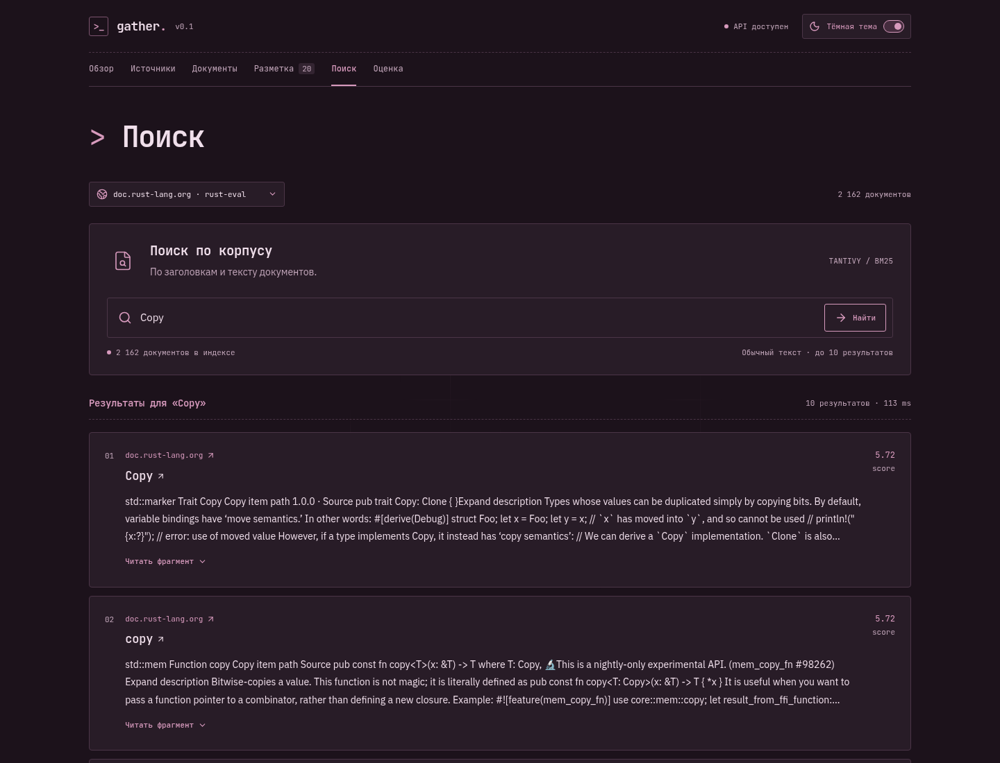

# MAS Crawler / Gather

Gather - конструктор поисковых движков для сайтов. Целевой сценарий: указать URL и получить самостоятельный проект поиска по этому сайту, который запускается без Gather и доступа к LLM.



## Что уже работает

- **Сбор из URL и цели.** LLM-агент составляет план обхода и извлечения текста; Rust собирает корпус и строит индекс Tantivy.
- **Поиск и оценка.** В локальном UI доступны BM25, Dense (Sentence Transformers + Qdrant) и Hybrid (взвешенный RRF), ручная разметка релевантности и сохранённые сравнения конфигураций.
- **Агентный подбор BM25.** В CLI и UI агент предлагает новые веса заголовка и текста; победитель определяется по метрикам на `dev`. В UI его можно автоматически применить для источника.
- **Самостоятельный сервис.** BM25-конфигурацию можно экспортировать из сохранённого сравнения в ZIP с корпусом, исходниками FastAPI/Tantivy и Dockerfile. Индекс строится при развёртывании; страницы поиска в ZIP нет.

## Быстрый старт

Нужны Python 3.12+, `uv`, Rust с поддержкой edition 2024, системный линкер, `just` и Node.js 22.12+ с npm.

```bash
just setup
just ui-build
just ui
```

Откройте <http://127.0.0.1:8000>. Для нового сбора укажите URL и цель. Для анализа сайта и генерации заданий разметки добавьте в `.env` ключ OpenAI-совместимого API (`LLM_API_KEY`) и при необходимости адрес провайдера (`LLM_BASE_URL`). Для поиска по готовому источнику LLM не нужна. Для Dense и Hybrid нужен запущенный Qdrant.

## Документация

- [Запуск, сбор и устройство системы](docs/operation.md) - конфигурация, Docker, CLI, артефакты, диагностика и проверки.
- [Поиск и экспорт](docs/retrieval.md) - BM25, Dense, Hybrid, Python API и самостоятельный сервис.
- [Разметка, оценка и агент](docs/evaluation.md) - `dev`/`test`, метрики, цикл оптимизации и применение победителя.

## TODO

- [ ] Добавить автономный экспорт Dense и Hybrid из сохранённого сравнения;
- [ ] Расширить агентный цикл: сравнивать BM25, Dense и Hybrid на готовых индексах и подбирать параметры поиска;
- [ ] Экспортировать выбранную агентом конфигурацию прямо из отчёта оптимизации;
- [ ] Связать сбор, построение индексов, выбор конфигурации и экспорт.
